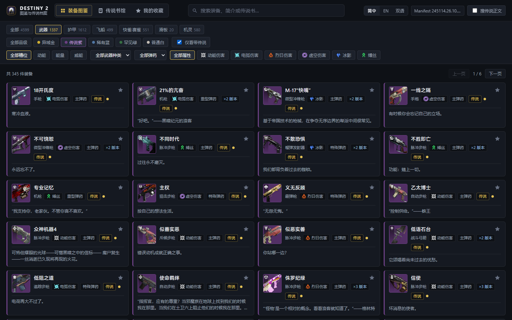
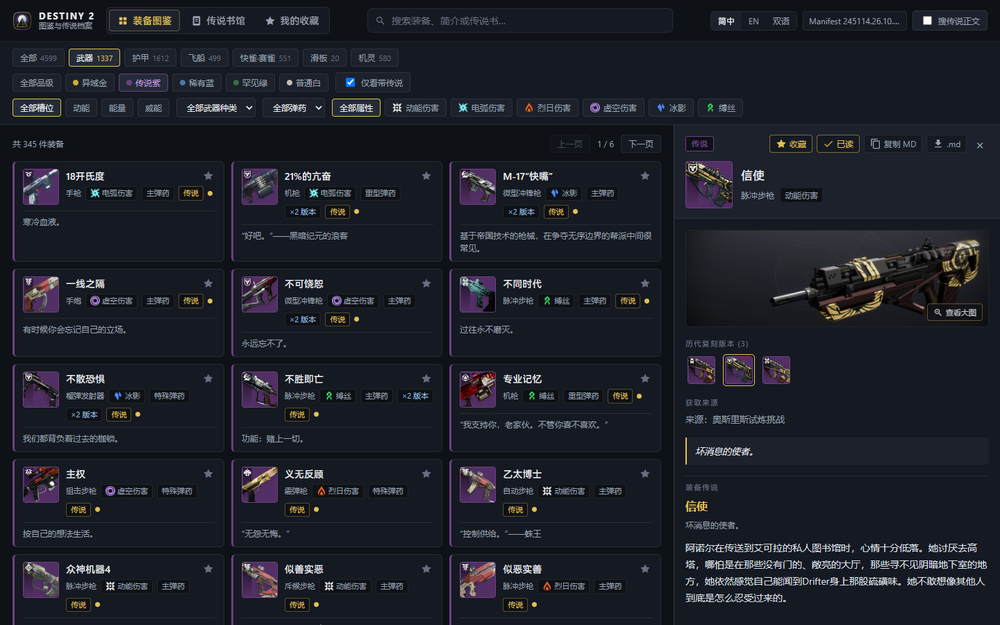
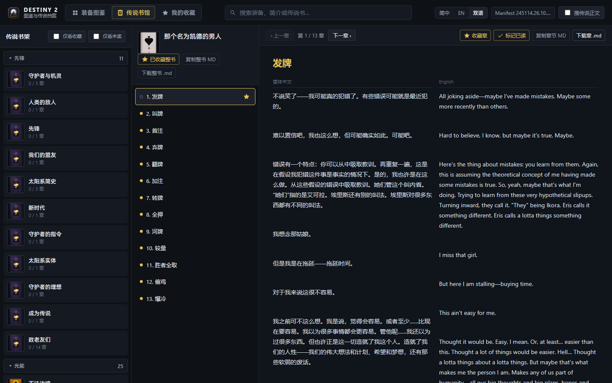
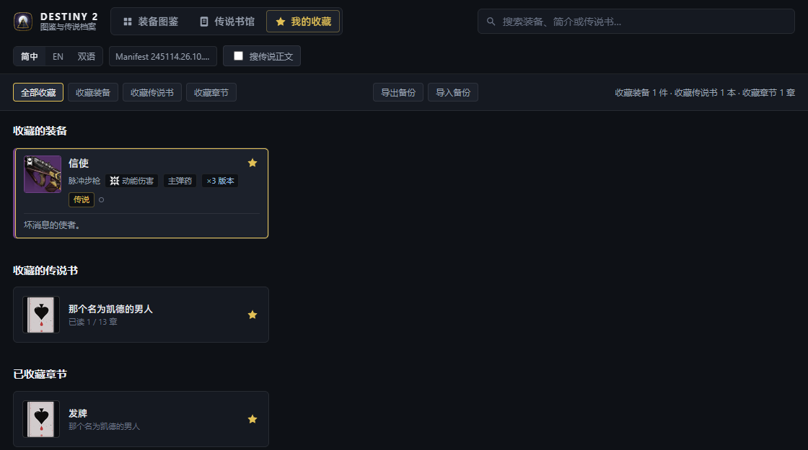

<div align="center">
  <h1>Destiny 2 Library</h1>
  <p>A bilingual Destiny 2 gear and lore library in Simplified Chinese and English</p>
  <p><a href="README.md">简体中文</a> · <strong>English</strong></p>
  <p><strong><a href="https://cyde-6.github.io/destiny2-library/">Open the library →</a></strong></p>
  <p>
    <a href="https://cyde-6.github.io/destiny2-library/"></a>
    <a href="LICENSE"></a>
    <a href="https://bungie-net.github.io/multi/operation_get_Destiny2-GetDestinyManifest.html"></a>
  </p>
</div>

## Features

- **Browse gear** · Search weapons, armor, ships, and more in either language. Filter by rarity, damage type, or class, and inspect acquisition sources and reissues.
- **Read lore** · Browse books and chapters, read in either language or side by side, and search the full text on demand.
- **Keep notes** · Copy or download Markdown, save favorites and read marks in your browser, and move them between browsers with a JSON backup.

## Usage

Choose **EN** in the top bar to switch the interface to English. The screenshots below show the default Chinese interface and the bilingual lore reader.

### 1. Search and filter gear

Open **Gear** and enter a Chinese or English name in the search bar. Choose **Weapons** to narrow the results by rarity, slot, weapon type, ammo, or damage type. Turn on **Has Lore** to show only gear with lore entries.



### 2. Inspect gear details and reissues

Select a gear card to open its details. Click the preview image to enlarge it when one is available. For items with multiple releases, select a reissue icon to compare icons and watermarks. Use **Copy MD** or **.md** to export the item as Markdown.



### 3. Read and search lore

Open **Lore Books**, pick a book on the left, and select a chapter in the middle. Choose **双语** in the top bar to display Chinese and English side by side. You can export the whole book or use the controls in the reader to export the current chapter.



To find a phrase in the text, enter it in the search bar and enable **Search Lore Text**. The site loads the full-text index on demand. In **Lore Books**, each book with matches shows a chapter count. Select the book to jump to the first matching chapter. In **Gear**, matching lore excerpts are highlighted on item cards.

### 4. Save favorites, track reading, and back up your records

Use the star to save gear, books, or individual chapters. You can also mark gear and chapters as read. Open **Favorites** to return to saved entries. To move records to another browser or device, choose **Export Backup**, then **Import Backup** in the other browser to merge the JSON backup into your existing records.



## Build and preview locally

Use Python 3.11 or newer. The first build downloads the bilingual Bungie Manifest tables and caches them for later runs. Set `BUNGIE_API_KEY` in your environment if you have a key.

```sh
python scripts/build_static.py --out dist
python scripts/preview.py
```

Open <http://127.0.0.1:8080/>. Use `--port` to change the preview port, `--cache-dir` to change the cache location, or `--raw-dir <version-directory>` to build offline from a directory containing the cached `en/` and `zh-chs/` tables. Use `--check-only` to compare Bungie's current Manifest version with your existing build.

## Deploy to GitHub Pages

Push the source to `main` and set **GitHub Actions** as the source under **Settings → Pages → Build and deployment**. Add `BUNGIE_API_KEY` as an Actions secret if you use a key. The workflow builds and deploys on pushes to `main`, every Wednesday at 18:00 UTC, and on manual dispatch. Git ignores the generated `dist/` and raw Manifest cache.

## Bungie fan content

This is an unofficial fan project. Bungie does not sponsor, endorse, or administer it. Destiny 2 and its associated names, images, and lore belong to Bungie and their respective rights holders. The MIT license covers the project source code. [Bungie Fan Content Policy](https://www.bungie.net/7/en/Legal/IntellectualPropertyTrademarks)
