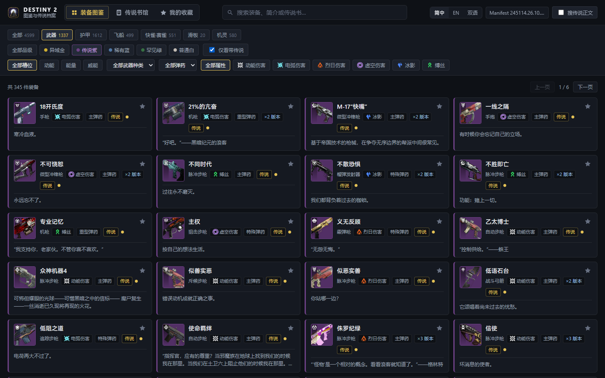
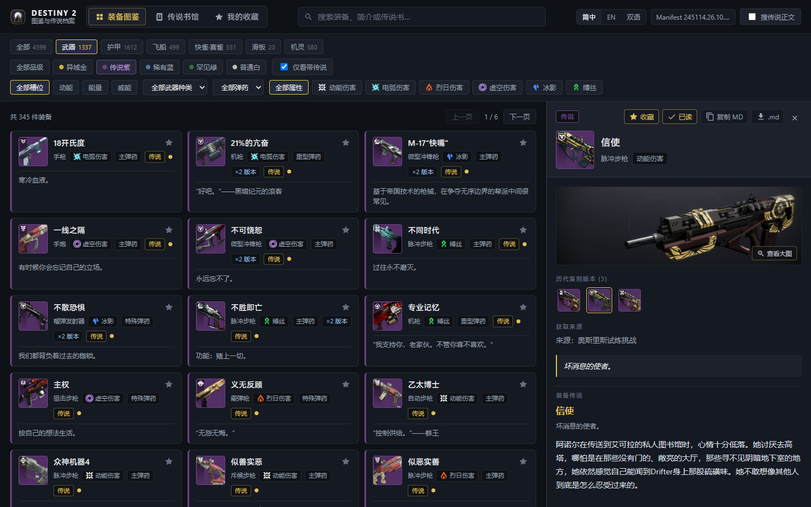
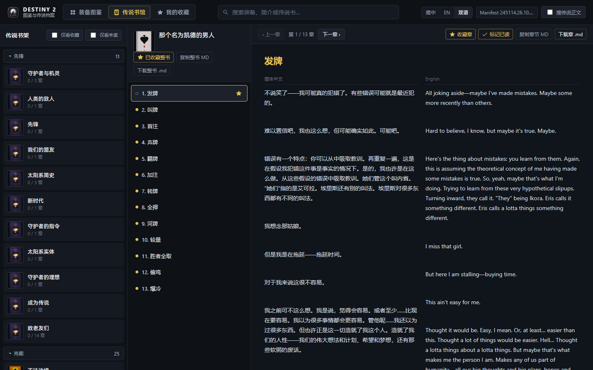
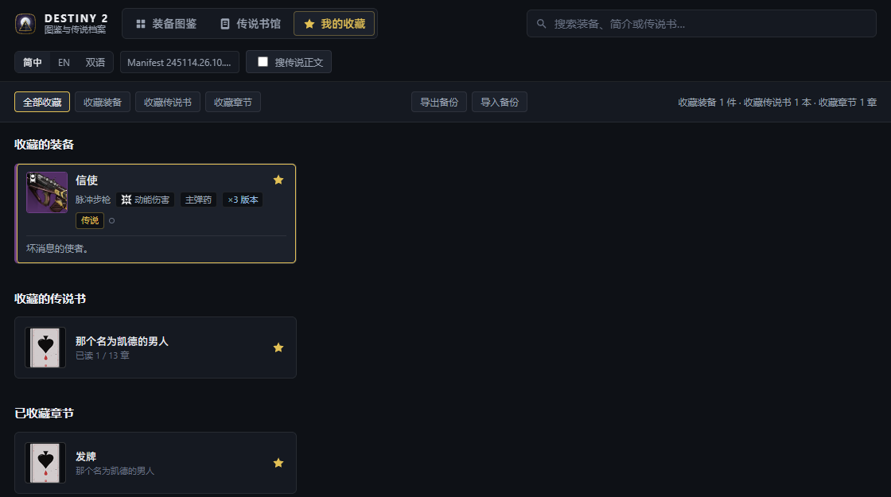

<div align="center">
  <h1>命运 2 图鉴</h1>
  <p>《命运 2》中英双语装备图鉴与传说书馆</p>
  <p><strong>简体中文</strong> · <a href="README.en.md">English</a></p>
  <p><strong><a href="https://cyde-6.github.io/destiny2-library/">在线体验 →</a></strong></p>
  <p>
    <a href="https://cyde-6.github.io/destiny2-library/"></a>
    <a href="LICENSE"></a>
    <a href="https://bungie-net.github.io/multi/operation_get_Destiny2-GetDestinyManifest.html"></a>
  </p>
</div>

## 功能亮点

- **查装备** · 用中英文搜索武器、护甲、飞船等装备，按稀有度、伤害属性、职业等条件筛选，查看获取来源和复刻版本。
- **读传说** · 在章节间切换，用简中、英文或双语模式阅读，并按需搜索传说正文。
- **做笔记** · 复制或下载装备与传说的 Markdown，在浏览器保存收藏和已读记录，并用 JSON 备份迁移。

## 使用说明

### 1. 搜索和筛选装备

打开「装备图鉴」，在顶部搜索框输入中文或英文名称。选中「武器」后，可以继续按稀有度、栏位、种类、弹药或伤害属性缩小范围。勾选「仅看带传说」即可只显示附有传说的装备。



### 2. 查看装备详情和复刻版本

点击装备卡片打开详情。若装备有高清展示图，可点图放大。有多个复刻版本时，点击版本图标可对比各版本的图标和水印。用「复制 MD」或「.md」将装备详情导出为 Markdown。



### 3. 阅读与检索传说

打开「传说书馆」，从左栏选书、中栏选章节，在右栏阅读。点击顶部「双语」可对照中英文正文。可以导出整本传说书，也可以通过阅读区的按钮单独导出当前章节。



想查正文里的词句时，在顶部搜索框输入关键词并勾选「搜传说正文」。站点会按需加载正文索引。在传说书馆，书名下方会显示命中的章节数，点开书可直达首个匹配章节。在装备图鉴，匹配的传说片段会在装备卡片中高亮显示。

### 4. 收藏、标记已读与备份

点击星标收藏装备、传说书或章节，也可以为装备和章节标记已读。「我的收藏」可以回到已收藏的条目。记录保存在当前浏览器。换浏览器或换设备时，先点「导出备份」取得 JSON 文件，再在新浏览器点「导入备份」，把收藏和已读记录合并到已有记录中。



## 本地构建

需要 Python 3.11 或更新版本。首次构建会从 Bungie 下载双语清单分表，之后可复用缓存。可设置环境变量 `BUNGIE_API_KEY` 使用自己的 Bungie API 密钥。

```sh
python scripts/build_static.py --out dist
python scripts/preview.py
```

浏览器打开 <http://127.0.0.1:8080/>。可用 `--port` 更改预览端口，用 `--cache-dir` 更改缓存目录。已有包含 `en/` 和 `zh-chs/` 分表的版本目录时，可通过 `--raw-dir <版本目录>` 离线构建。使用 `--check-only` 可查看官方清单版本和相对于现有构建的变更状态。

## GitHub Pages 部署

将源码推送到 `main`，在仓库的 **Settings → Pages → Build and deployment** 中将来源设为 **GitHub Actions**。可选的 `BUNGIE_API_KEY` 通过仓库的 Actions secret 配置。工作流会在推送到 `main` 后、每周三 UTC 18:00 及手动触发时构建和部署。生成的 `dist/` 和原始清单缓存由 Git 忽略。

## Bungie 同人内容声明

本项目是非官方同人项目。Bungie 未赞助、认可或管理本项目。《命运 2》及相关名称、图像和传说文本的权利归 Bungie 及相应权利人所有。MIT 许可证适用于项目代码。 [Bungie 同人内容政策](https://www.bungie.net/7/en/Legal/IntellectualPropertyTrademarks)
